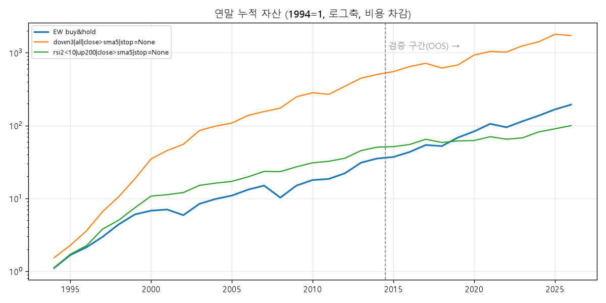

# 03. 전략 백테스트

- 유니버스: 미국 대형주 77+ETF 18(생존편향 있음, 02·ETF 점검 참고), 슬롯 10개 동일비중, 편도 비용 0.05%
- 체결: 신호일 종가 판정 → 다음날 시가 매수, 청산 신호 다음날 시가 매도, 손절은 장중 손절가
- 절차: 144개 규칙을 **1994~2014(IS)** 에서만 Sharpe로 순위 → 상위 10개를 **2015~2026-10(OOS)** 에서 1회 검증

## 1. IS 상위 15개 (학습 구간)

| 규칙 | CAGR | MDD | Sharpe | 거래수 | 승률 | 평균/거래 |
|---|---|---|---|---|---|---|
| `down3|all|close>sma5|stop=None` | 34.5% | -31.4% | 1.55 | 10418 | 66.6% | 0.61% |
| `down3|up200|close>sma5|stop=None` | 23.2% | -19.5% | 1.54 | 8347 | 66.8% | 0.53% |
| `down3|all|up_close|stop=None` | 30.0% | -22.9% | 1.51 | 15373 | 61.0% | 0.36% |
| `rsi2<5|up200|close>sma5|stop=None` | 17.4% | -15.1% | 1.50 | 4660 | 68.9% | 0.72% |
| `down3|all|close>sma5|stop=3.0` | 32.4% | -31.8% | 1.50 | 11023 | 66.6% | 0.56% |
| `down3|up200|up_close|stop=None` | 17.6% | -14.4% | 1.49 | 10981 | 61.4% | 0.31% |
| `down3|all|up_close|stop=3.0` | 28.1% | -24.1% | 1.45 | 15747 | 61.0% | 0.34% |
| `down3|all|rsi2>70|stop=None` | 32.1% | -33.7% | 1.44 | 8854 | 68.3% | 0.68% |
| `rsi2<25|up200|close>sma5|stop=None` | 26.0% | -22.5% | 1.43 | 11390 | 65.3% | 0.43% |
| `ibs<0.2&down|up200|close>sma5|stop=None` | 25.9% | -25.5% | 1.42 | 13250 | 65.4% | 0.37% |
| `down3|up200|up_close|stop=3.0` | 16.3% | -15.7% | 1.42 | 11173 | 61.6% | 0.29% |
| `rsi2<15|up200|close>sma5|stop=None` | 23.1% | -20.1% | 1.42 | 9146 | 65.6% | 0.48% |
| `rsi2<25|up200|rsi2>70|stop=None` | 26.1% | -28.6% | 1.41 | 9337 | 67.8% | 0.53% |
| `down3|up200|close>sma5|stop=3.0` | 20.4% | -19.6% | 1.41 | 8762 | 66.7% | 0.46% |
| `rsi2<5|up200|close>sma5|stop=3.0` | 15.5% | -14.8% | 1.41 | 4871 | 68.7% | 0.63% |

IS 비교군:

| 비교군 | CAGR | MDD | Sharpe |
|---|---|---|---|
| BENCH equal-weight B&H | 18.5% | -49.2% | 0.98 |
| BENCH SPY B&H | 9.3% | -55.2% | 0.56 |

## 2. 같은 규칙의 OOS 성과 (검증 구간)

| 규칙 | IS Sharpe | CAGR | MDD | Sharpe | 거래수 | 승률 | 평균/거래 |
|---|---|---|---|---|---|---|---|
| `rsi2<5|up200|close>sma5|stop=None` | 1.50 | 5.4% | -16.0% | 0.56 | 2824 | 63.3% | 0.22% |
| `rsi2<25|up200|close>sma5|stop=None` | 1.43 | 7.0% | -24.5% | 0.50 | 6477 | 63.2% | 0.13% |
| `down3|all|close>sma5|stop=None` | 1.55 | 11.1% | -41.7% | 0.68 | 5961 | 64.1% | 0.23% |
| `down3|all|close>sma5|stop=3.0` | 1.50 | 11.7% | -35.2% | 0.74 | 6366 | 64.1% | 0.23% |
| `down3|all|rsi2>70|stop=None` | 1.44 | 14.1% | -38.6% | 0.81 | 5032 | 65.5% | 0.33% |
| `down3|all|up_close|stop=None` | 1.51 | 10.6% | -28.1% | 0.75 | 9192 | 57.9% | 0.14% |
| `down3|all|up_close|stop=3.0` | 1.45 | 9.5% | -28.8% | 0.69 | 9465 | 57.9% | 0.12% |
| `down3|up200|close>sma5|stop=None` | 1.54 | 6.3% | -31.8% | 0.51 | 4939 | 64.0% | 0.15% |
| `down3|up200|up_close|stop=None` | 1.49 | 4.8% | -23.9% | 0.49 | 6831 | 57.8% | 0.09% |
| `ibs<0.2&down|up200|close>sma5|stop=None` | 1.42 | 6.6% | -26.1% | 0.48 | 7335 | 62.7% | 0.11% |
| `BENCH equal-weight B&H` | 0.98 | 15.5% | -33.6% | 0.95 |  |  |  |
| `BENCH SPY B&H` | 0.56 | 13.7% | -33.7% | 0.82 |  |  |  |

## 3. 대안 전략 (추세 타이밍·모멘텀·타 시장)

| 전략 | 구간 | CAGR | MDD | Sharpe | 거래수 | 승률 | 평균/거래 |
|---|---|---|---|---|---|---|---|
| SPY buy&hold | IS | 9.3% | -55.2% | 0.56 |  |  |  |
| SPY timing SMA50 | IS | 4.1% | -40.7% | 0.41 |  |  |  |
| SPY timing SMA100 | IS | 5.3% | -51.1% | 0.50 |  |  |  |
| SPY timing SMA200 | IS | 7.5% | -28.6% | 0.65 |  |  |  |
| SPY buy&hold | OOS | 13.7% | -33.7% | 0.82 |  |  |  |
| SPY timing SMA50 | OOS | 5.0% | -19.3% | 0.51 |  |  |  |
| SPY timing SMA100 | OOS | 9.6% | -16.6% | 0.88 |  |  |  |
| SPY timing SMA200 | OOS | 9.1% | -19.5% | 0.79 |  |  |  |
| US stocks EW buy&hold | IS | 19.7% | -49.7% | 1.01 |  |  |  |
| US stocks EW timing SMA200 | IS | 10.9% | -25.2% | 1.05 |  |  |  |
| US stocks EW buy&hold | OOS | 16.5% | -34.0% | 0.97 |  |  |  |
| US stocks EW timing SMA200 | OOS | 8.7% | -14.3% | 1.00 |  |  |  |
| US momentum 12-1 top10 | IS | 28.3% | -44.1% | 1.09 |  |  |  |
| US momentum 12-1 top10 | OOS | 23.9% | -33.6% | 0.99 |  |  |  |
| MR down3 on KR stocks | IS | 19.5% | -31.4% | 1.34 | 2240 | 68.8% | 1.21% |
| MR down3 on KR stocks | OOS | 7.4% | -20.3% | 0.63 | 1906 | 65.3% | 0.46% |
| MR down3 on ETFs | IS | 5.7% | -22.1% | 0.59 | 2862 | 69.1% | 0.42% |
| MR down3 on ETFs | OOS | 3.0% | -35.7% | 0.32 | 2232 | 67.1% | 0.18% |
| KR stocks EW buy&hold | IS | 16.5% | -53.2% | 0.66 |  |  |  |
| ETF EW buy&hold | IS | 10.8% | -47.7% | 0.67 |  |  |  |
| KR stocks EW buy&hold | OOS | 16.9% | -37.5% | 0.80 |  |  |  |
| ETF EW buy&hold | OOS | 11.2% | -32.1% | 0.78 |  |  |  |

## 4. 무작위 진입 대비 (몬테카를로 300회)

| 규칙 | 구간 | 실제 평균 | 무작위 평균 | p(평균) | 실제 승률 | 무작위 승률 | p(승률) |
|---|---|---|---|---|---|---|---|
| `down3|all|close>sma5|stop=None` | IS | 0.61% | 0.17% | 0.00 | 66.6% | 51.2% | 0.00 |
| `down3|all|close>sma5|stop=None` | OOS | 0.23% | 0.13% | 0.03 | 64.1% | 51.7% | 0.00 |
| `rsi2<10|up200|close>sma5|stop=None` | IS | 0.53% | 0.18% | 0.00 | 66.5% | 51.4% | 0.00 |
| `rsi2<10|up200|close>sma5|stop=None` | OOS | 0.17% | 0.16% | 0.46 | 63.0% | 52.4% | 0.00 |

## 5. 비용 민감도 (OOS)

| 규칙 | 편도비용 | CAGR | MDD | Sharpe |
|---|---|---|---|---|
| `down3|all|close>sma5|stop=None` | 0.05% | 11.1% | -41.7% | 0.68 |
| `down3|all|close>sma5|stop=None` | 0.10% | 5.6% | -46.6% | 0.39 |
| `down3|all|close>sma5|stop=None` | 0.20% | -4.6% | -60.3% | -0.17 |
| `rsi2<10|up200|close>sma5|stop=None` | 0.05% | 5.9% | -31.3% | 0.47 |
| `rsi2<10|up200|close>sma5|stop=None` | 0.10% | 2.1% | -36.0% | 0.22 |
| `rsi2<10|up200|close>sma5|stop=None` | 0.20% | -5.2% | -53.4% | -0.30 |

## 6. 슬롯 수 K 민감도 (OOS)

| 규칙 | K | CAGR | MDD | Sharpe |
|---|---|---|---|---|
| `down3|all|close>sma5|stop=None` | 5 | 13.5% | -48.0% | 0.70 |
| `down3|all|close>sma5|stop=None` | 10 | 11.1% | -41.7% | 0.68 |
| `down3|all|close>sma5|stop=None` | 20 | 10.0% | -36.3% | 0.70 |
| `rsi2<10|up200|close>sma5|stop=None` | 5 | 7.1% | -40.0% | 0.49 |
| `rsi2<10|up200|close>sma5|stop=None` | 10 | 5.9% | -31.3% | 0.47 |
| `rsi2<10|up200|close>sma5|stop=None` | 20 | 5.9% | -21.6% | 0.60 |

## 7. 연도별 수익

| 연도 | EW buy&hold | down3|all|close>sma5|stop=None | rsi2<10|up200|close>sma5|stop=None |
|---|---|---|---|
| 1994 | 10.8% | 53.1% | 11.3% |
| 1995 | 50.3% | 47.9% | 53.4% |
| 1996 | 27.7% | 57.9% | 31.2% |
| 1997 | 39.4% | 83.9% | 68.9% |
| 1998 | 48.4% | 60.5% | 32.9% |
| 1999 | 36.9% | 76.1% | 47.9% |
| 2000 | 12.5% | 87.3% | 44.5% |
| 2001 | 3.6% | 30.5% | 4.7% |
| 2002 | -16.3% | 21.6% | 6.8% |
| 2003 | 43.2% | 55.0% | 25.5% |
| 2004 | 16.6% | 14.8% | 7.4% |
| 2005 | 11.3% | 10.0% | 5.6% |
| 2006 | 20.5% | 27.3% | 15.3% |
| 2007 | 13.8% | 13.1% | 18.9% |
| 2008 | -31.7% | 11.4% | -0.7% |
| 2009 | 46.4% | 42.7% | 16.4% |
| 2010 | 19.1% | 14.0% | 13.6% |
| 2011 | 3.6% | -5.0% | 4.7% |
| 2012 | 19.7% | 29.0% | 10.2% |
| 2013 | 39.8% | 29.5% | 27.5% |
| 2014 | 14.1% | 12.4% | 11.4% |
| 2015 | 4.9% | 9.3% | 1.8% |
| 2016 | 16.9% | 17.1% | 6.7% |
| 2017 | 25.0% | 11.0% | 18.2% |
| 2018 | -3.4% | -13.9% | -9.6% |
| 2019 | 31.1% | 10.3% | 4.9% |
| 2020 | 21.3% | 36.7% | 1.2% |
| 2021 | 27.1% | 12.0% | 13.1% |
| 2022 | -10.4% | -2.1% | -7.7% |
| 2023 | 21.2% | 22.3% | 4.5% |
| 2024 | 19.3% | 13.1% | 20.7% |
| 2025 | 21.7% | 27.0% | 10.1% |
| 2026 | 16.3% | -4.0% | 10.9% |
