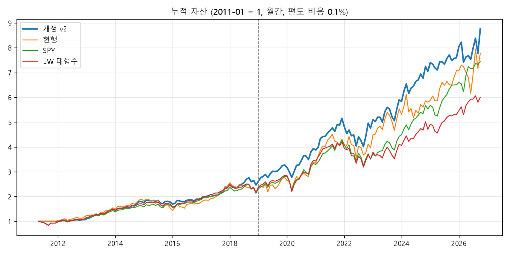

# 03. 실험 결과 (자동 생성: src/report.py)

- 학습(IS) 2011.01~2018.12 / 검증(OOS) 2019.01~2026.10, 월간, 편도 비용 0.1%, 시점 정확한 SEC 최초 공시값(first)
- 기준 = 문서 규칙 그대로(등급별 목표가 S×0.9·A×0.85·일반×0.8, 10종목, 갈아타기 +15%p). 한 번에 한 요소만 바꿈
- 판단은 학습 구간으로 하고 검증 구간은 확인용으로만 본다

## 1. 한 요소씩 바꾸기

| 묶음 | 실험 | IS CAGR | IS Sharpe | IS MDD | OOS CAGR | OOS Sharpe | OOS MDD | 평균 보유 |
|---|---|---|---|---|---|---|---|---|
| bench | SPY | 10.8% | 0.95 | -16.2% | 17.2% | 1.06 | -23.9% |  |
| bench | EW 대형주(>=$10B) | 10.9% | 0.94 | -16.6% | 13.9% | 0.85 | -24.3% |  |
| base | 문서 규칙 그대로 | 10.3% | 0.81 | -24.1% | 18.0% | 0.85 | -20.7% | 10.0 |
| base | 품질만(가격 무시, 통과 전부) | 11.6% | 1.05 | -13.0% | 15.8% | 0.92 | -26.0% | 124.5 |
| base | 품질만 S·A | 11.5% | 1.08 | -11.3% | 14.7% | 0.88 | -22.7% | 69.9 |
| price | IV에 매수(배수 1.0) | 10.2% | 0.79 | -23.5% | 19.6% | 0.94 | -19.2% | 10.0 |
| price | 문서보다 깐깐(0.8/0.75/0.7) | 10.4% | 0.83 | -22.3% | 18.2% | 0.86 | -20.0% | 10.0 |
| price | 매우 깐깐(0.7/0.65/0.6) | 10.9% | 0.84 | -21.2% | 13.8% | 0.68 | -27.6% | 9.9 |
| price | 등급 무관 일률 0.8 | 10.0% | 0.78 | -23.5% | 19.5% | 0.94 | -19.2% | 10.0 |
| price | 스크린B식: 52주 −30% | 4.6% | 0.43 | -21.4% | 18.8% | 0.80 | -22.8% | 9.8 |
| price | 스크린B식: 52주 −20% | 9.0% | 0.69 | -25.7% | 17.7% | 0.84 | -20.4% | 10.0 |
| price | 가격 무시 + 싼 순 10개 | 10.0% | 0.78 | -24.1% | 21.1% | 0.98 | -19.2% | 10.0 |
| grade | S·A만 | 10.3% | 0.84 | -16.9% | 15.5% | 0.74 | -28.1% | 9.8 |
| grade | ROIC 문턱 10% | 9.5% | 0.67 | -27.3% | 14.2% | 0.73 | -22.7% | 10.0 |
| grade | ROIC 문턱 20% | 9.1% | 0.68 | -21.6% | 19.1% | 0.88 | -22.2% | 9.8 |
| grade | ROIC 문턱 25% | 9.5% | 0.78 | -17.7% | 19.7% | 0.90 | -27.5% | 9.5 |
| grade | 경기순환 숫자판정 끔 | 9.8% | 0.76 | -22.9% | 17.5% | 0.81 | -26.5% | 10.0 |
| grade | ROIC 미달 = 경고(탈락 아님) | 10.0% | 0.71 | -32.2% | 13.3% | 0.67 | -24.0% | 10.0 |
| grade | 섹터 제외 끔 | 9.3% | 0.72 | -21.1% | 16.0% | 0.73 | -25.7% | 10.0 |
| value | 종료PER 배수 0.8 | 11.2% | 0.86 | -20.7% | 19.9% | 0.94 | -21.9% | 10.0 |
| value | 종료PER 배수 1.0 | 10.8% | 0.85 | -23.4% | 23.0% | 1.09 | -19.2% | 10.0 |
| value | 종료PER 상한 30 | 10.3% | 0.81 | -24.1% | 18.6% | 0.88 | -18.0% | 10.0 |
| value | 종료PER 상한 99 | 8.0% | 0.62 | -26.2% | 16.3% | 0.76 | -19.6% | 10.0 |
| value | 성장률 haircut 0.6 | 12.3% | 0.93 | -17.8% | 17.0% | 0.80 | -27.8% | 9.9 |
| value | 성장률 haircut 1.0 | 7.9% | 0.62 | -25.6% | 16.3% | 0.77 | -23.2% | 10.0 |
| value | 성장률 상한 10% | 9.3% | 0.70 | -20.5% | 12.9% | 0.65 | -24.3% | 9.8 |
| value | 성장률 상한 12% | 7.4% | 0.59 | -24.3% | 17.2% | 0.81 | -23.2% | 10.0 |
| value | 기준이익 = FCF−SBC | 11.8% | 0.98 | -20.5% | 14.5% | 0.75 | -28.8% | 10.0 |
| value | 기준이익 = min(순이익, FCF−SBC) | 10.5% | 0.81 | -21.0% | 9.8% | 0.52 | -26.3% | 9.9 |
| value | 할인율 8% | 10.9% | 0.86 | -21.3% | 18.9% | 0.88 | -20.4% | 10.0 |
| value | 할인율 10% | 10.2% | 0.78 | -22.7% | 19.6% | 0.92 | -20.0% | 10.0 |
| port | 슬롯 5 | 8.3% | 0.57 | -28.2% | 12.4% | 0.58 | -36.0% | 5.0 |
| port | 슬롯 20 | 9.8% | 0.87 | -16.8% | 16.4% | 0.82 | -22.0% | 19.8 |
| exit | 갈아타기 격차 None | 11.7% | 0.97 | -19.1% | 14.6% | 0.78 | -24.8% | 10.0 |
| exit | 갈아타기 격차 0.05 | 10.6% | 0.80 | -23.4% | 17.6% | 0.83 | -19.2% | 10.0 |
| exit | 갈아타기 격차 0.3 | 8.6% | 0.69 | -24.5% | 15.4% | 0.71 | -26.3% | 10.0 |
| exit | 낙관IV×1.0 넘으면 매도 | 10.3% | 0.81 | -24.1% | 18.0% | 0.85 | -20.7% | 10.0 |
| exit | 낙관IV×1.3 넘으면 매도 | 10.3% | 0.81 | -24.1% | 18.0% | 0.85 | -20.7% | 10.0 |
| port | 시총 문턱 $2B | 8.9% | 0.61 | -29.8% | 18.3% | 0.75 | -31.2% | 10.0 |
| overhaul | 재구성 qv 상위20 12개월 | 11.3% | 1.09 | -10.8% | 16.8% | 0.97 | -23.0% | 19.4 |
| overhaul | 재구성 qv 상위20 3개월 | 11.3% | 1.09 | -10.4% | 18.8% | 1.06 | -22.1% | 19.6 |
| overhaul | 재구성 qv 상위10 12개월 | 12.4% | 1.07 | -16.2% | 17.6% | 1.00 | -25.7% | 9.7 |
| overhaul | 재구성 fcf_yield 상위20 12개월 | 10.7% | 1.01 | -11.8% | 16.7% | 1.04 | -17.4% | 19.0 |
| overhaul | 재구성 fcf_yield 상위20 3개월 | 10.4% | 0.99 | -12.8% | 17.8% | 1.02 | -18.7% | 19.4 |
| overhaul | 재구성 fcf_yield 상위10 12개월 | 9.0% | 0.73 | -20.4% | 14.1% | 0.79 | -22.3% | 9.2 |
| overhaul | 재구성 earn_yield 상위20 12개월 | 8.3% | 0.78 | -15.2% | 16.8% | 0.95 | -20.3% | 18.7 |
| overhaul | 재구성 earn_yield 상위20 3개월 | 8.0% | 0.73 | -16.2% | 17.0% | 0.92 | -23.7% | 19.3 |
| overhaul | 재구성 earn_yield 상위10 12개월 | 3.5% | 0.33 | -27.5% | 17.1% | 0.92 | -21.1% | 9.3 |
| overhaul | 재구성 roic_med5 상위20 12개월 | 12.5% | 1.13 | -13.0% | 15.6% | 0.90 | -28.1% | 19.7 |
| overhaul | 재구성 roic_med5 상위20 3개월 | 12.3% | 1.12 | -11.8% | 17.0% | 0.94 | -28.6% | 19.8 |
| overhaul | 재구성 roic_med5 상위10 12개월 | 11.5% | 1.02 | -17.4% | 16.8% | 0.94 | -28.8% | 9.9 |
| overhaul | 재구성 qv 상위20 12개월 S·A만 | 12.2% | 1.17 | -10.6% | 14.8% | 0.92 | -23.3% | 19.5 |
| overhaul | 재구성 qv 상위20 12개월 IV이하만 | 8.6% | 0.80 | -16.0% | 15.6% | 0.92 | -21.4% | 18.6 |

## 2. 후보 규칙 이웃 격자 (품질 관문 + qv 순위 상위 N, k개월 재구성) — 전체 기간 Sharpe

| N \ 재구성(개월) | 1 | 2 | 3 | 6 | 12 |
|---|---|---|---|---|---|
| 10 | 1.01 | 1.03 | 1.01 | 1.08 | 1.01 |
| 15 | 1.05 | 1.02 | 1.01 | 0.96 | 0.91 |
| 20 | 1.02 | 1.04 | 1.04 | 0.98 | 0.98 |
| 25 | 1.07 | 1.06 | 0.99 | 0.98 | 0.97 |
| 30 | 0.99 | 0.96 | 1.00 | 0.98 | 1.02 |

## 3. 완충(보유 종목은 순위 buffer×N 안이면 유지) — N=20

| 완충 | 재구성 | 전체 CAGR | 전체 Sharpe | 전체 MDD | IS Sharpe | OOS Sharpe | 연 회전율 |
|---|---|---|---|---|---|---|---|
| 없음 | 3 | 15.0% | 1.04 | -22.1% | 1.09 | 1.06 | 80.0% |
| 없음 | 6 | 14.2% | 0.98 | -22.9% | 1.05 | 1.00 | 60.3% |
| 없음 | 12 | 14.0% | 0.98 | -23.0% | 1.09 | 0.97 | 48.4% |
| 1.5 | 3 | 15.0% | 1.07 | -22.2% | 1.19 | 1.05 | 48.7% |
| 1.5 | 6 | 14.8% | 1.05 | -22.6% | 1.15 | 1.05 | 44.2% |
| 1.5 | 12 | 13.7% | 0.99 | -22.9% | 1.12 | 0.96 | 40.6% |
| 2.0 | 3 | 14.8% | 1.04 | -22.0% | 1.13 | 1.04 | 42.3% |
| 2.0 | 6 | 15.9% | 1.12 | -22.2% | 1.12 | 1.18 | 39.0% |
| 2.0 | 12 | 13.7% | 1.00 | -22.1% | 1.09 | 0.98 | 36.1% |

## 4. 비용 민감도 (편도)

| 규칙 | 비용 | 전체 CAGR | 전체 Sharpe |
|---|---|---|---|
| qv N20 R3 | 0.1% | 15.0% | 1.04 |
| 현행 | 0.1% | 14.1% | 0.81 |
| qv N20 R3 | 0.3% | 14.7% | 1.02 |
| 현행 | 0.3% | 13.8% | 0.79 |

## 5. 재작성 공시값(last)으로 다시 계산

| 규칙 | 전체 CAGR | 전체 Sharpe | IS Sharpe | OOS Sharpe |
|---|---|---|---|---|
| v2 | 14.7% | 1.04 | 1.17 | 1.01 |
| 현행 | 14.8% | 0.84 | 0.82 | 0.89 |

## 6. 최종 비교

| 구간 | 전략 | CAGR | 변동성 | Sharpe | MDD |
|---|---|---|---|---|---|
| 2011~2018 | 개정 v2 | 12.5% | 10.4% | 1.19 | -10.6% |
| 2011~2018 | 현행 | 10.3% | 13.3% | 0.81 | -24.1% |
| 2011~2018 | SPY | 10.5% | 11.5% | 0.92 | -15.3% |
| 2011~2018 | EW 대형주 | 10.6% | 11.9% | 0.91 | -16.1% |
| 2019~2026.10 | 개정 v2 | 17.6% | 16.9% | 1.05 | -22.2% |
| 2019~2026.10 | 현행 | 18.0% | 22.4% | 0.85 | -20.7% |
| 2019~2026.10 | SPY | 17.2% | 16.3% | 1.06 | -23.9% |
| 2019~2026.10 | EW 대형주 | 13.9% | 17.2% | 0.85 | -24.3% |
| 전체 | 개정 v2 | 15.0% | 14.1% | 1.07 | -22.2% |
| 전체 | 현행 | 14.1% | 18.5% | 0.81 | -24.1% |
| 전체 | SPY | 13.8% | 14.1% | 0.99 | -23.9% |
| 전체 | EW 대형주 | 12.3% | 14.8% | 0.86 | -24.3% |

블록 부트스트랩(6개월 블록, 2,000회) — Sharpe 차이:

| 전략 | 비교 | 중앙 | 90% 구간 | P(차>0) |
|---|---|---|---|---|
| 개정 v2 | SPY | 0.08 | -0.17 ~ +0.31 | 0.70 |
| 개정 v2 | EW 대형주 | 0.21 | -0.02 ~ +0.44 | 0.93 |
| 현행 | SPY | -0.18 | -0.51 ~ +0.09 | 0.14 |
| 현행 | EW 대형주 | -0.05 | -0.35 ~ +0.21 | 0.38 |

## 7. 연도별 수익

| 연도 | 후보(qv N20 R3) | 문서 규칙 | 품질만 전부 | SPY | EW 대형주 |
|---|---|---|---|---|---|
| 2011 | 0.0% | 0.5% | -4.9% | -3.8% | -3.9% |
| 2012 | 6.8% | 17.0% | 19.0% | 16.0% | 17.8% |
| 2013 | 33.0% | 31.3% | 32.6% | 32.3% | 35.3% |
| 2014 | 15.8% | 22.1% | 13.8% | 13.5% | 15.2% |
| 2015 | -3.6% | -17.8% | 1.3% | 1.2% | -0.9% |
| 2016 | 6.7% | 10.9% | 9.1% | 12.0% | 11.0% |
| 2017 | 29.8% | 40.4% | 28.6% | 21.7% | 24.8% |
| 2018 | 3.4% | -11.9% | -4.4% | -4.6% | -7.7% |
| 2019 | 34.0% | 30.6% | 36.1% | 31.2% | 31.7% |
| 2020 | 16.3% | 22.1% | 30.2% | 18.3% | 21.2% |
| 2021 | 29.2% | 27.2% | 26.7% | 28.7% | 21.8% |
| 2022 | -9.1% | -8.2% | -17.7% | -18.2% | -16.5% |
| 2023 | 25.7% | 39.8% | 26.7% | 26.2% | 17.1% |
| 2024 | 23.2% | 4.9% | 10.5% | 24.9% | 14.5% |
| 2025 | 15.3% | 21.9% | 5.5% | 17.7% | 12.7% |
| 2026 | 18.0% | 9.8% | 15.2% | 14.3% | 13.1% |

